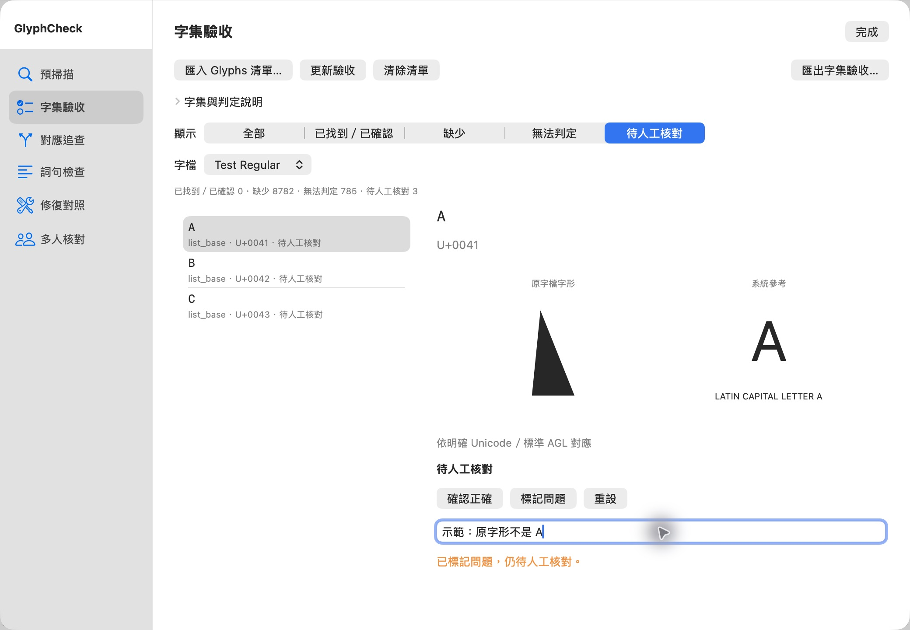
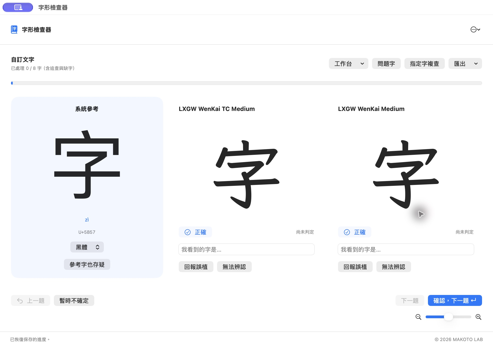
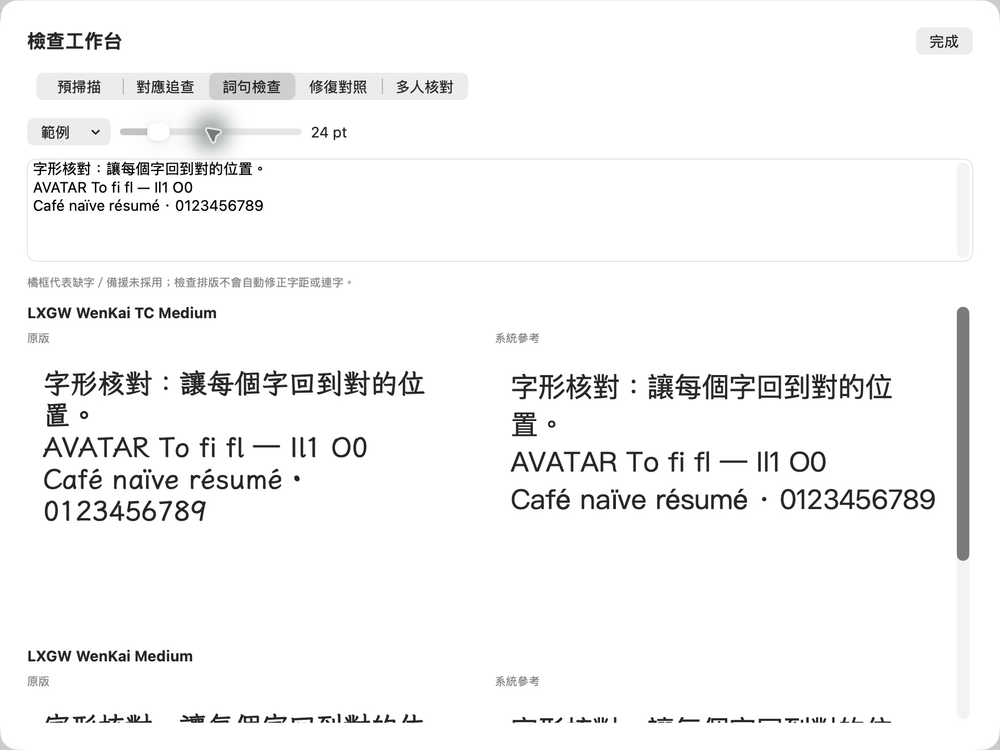
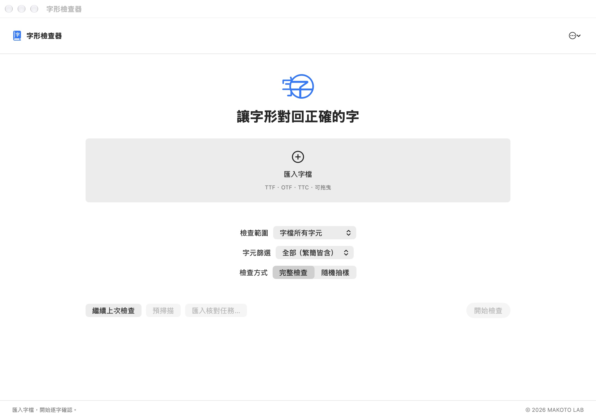
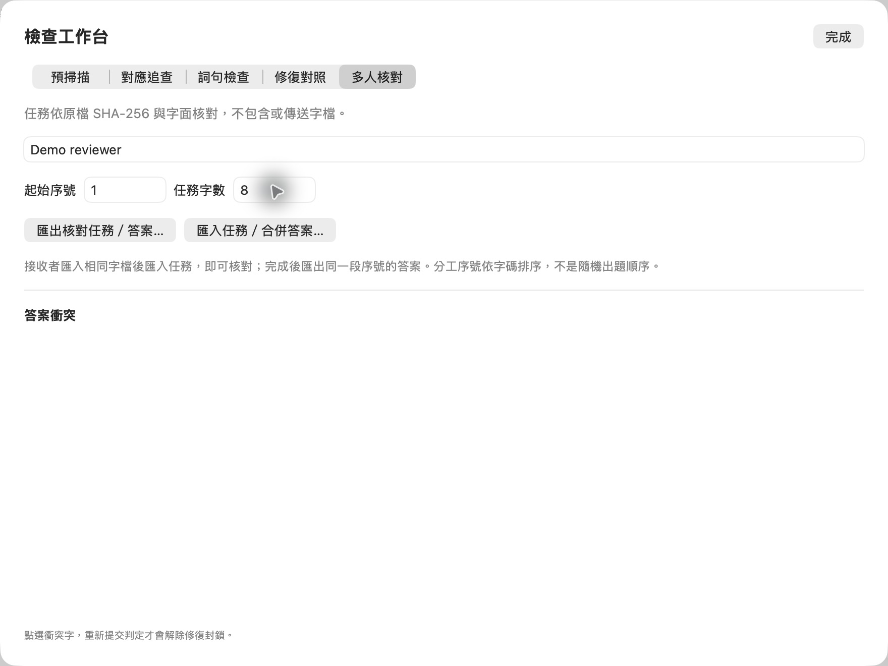
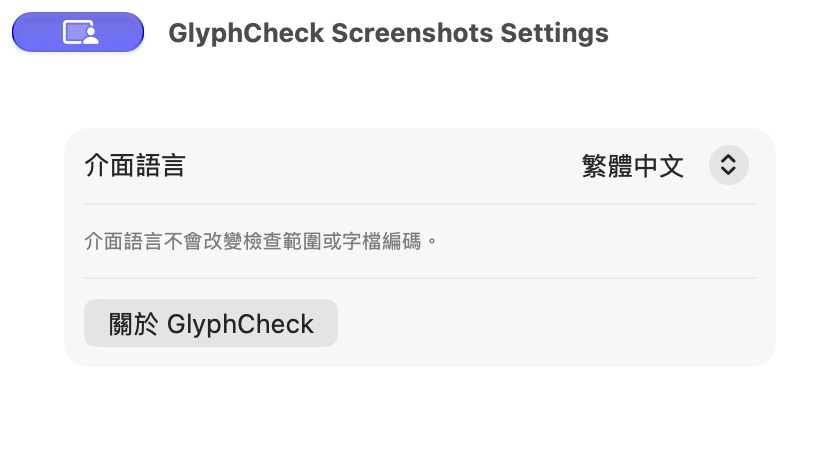

# GlyphCheck — 字形檢查器

A minimal native macOS tool for **human review of font glyphs and incorrect character mappings**, built with SwiftUI, AppKit and CoreText by [MAKOTO LAB](https://makotolab.tw/).

[](https://github.com/lancer1234/GlyphCheck/releases/latest)
[](https://github.com/lancer1234/GlyphCheck)
[](https://makotolab.tw/)
[](https://buymeacoffee.com/MakotoLab)

**Latest: 1.3.1** — Glyphs glyph-name list audits, synchronized article comparison, accepted cross-font repairs and visual reports.

### 1.3 新流程

1. **選任務：**「檢查這份字檔」「檢查這段文字」「整理與修復問題」。文字任務保留文章內容，只核對其中的不同非空白字元；修復入口可接續既有進度。
2. **匯入／保存字集：** 支援 UTF-8／UTF-16 文字檔、每行一個 `U+XXXX` 或 `0xXXXX`，以及 `.glyphset` JSON。字集可命名保存在本機，或匯出供下次使用；不內建或下載第三方字集。文字任務把 `U+0041` 等字串當實際文章內容，字表模式才解析逐行字碼。
3. **選出題方式：** 完整檢查、隨機抽樣、問題優先。問題優先按答案衝突／參考存疑、已回報字的追查目標、預掃描提示及文章字元分層；每層隨機。切換待確認字為優先順序，不更動原抽樣樣本；`reviewMode` 與 `queueMode` 分別記錄選字及排序。
4. **區分判定：** 正確、確定是另一個字、看不清／不知道、字形不同但可能合理。字形差異仍待確認，不當作修復 donor；系統參考不是唯一正確字形。含新判定的多人任務請使用 1.3 或以上版本匯入。
5. **匯出圖文報告：** `圖文核對報告.html` 可獨立開啟／分享，包含原字檔輪廓圖片、Unicode 名稱、人工看到的字、文章片段、字檔版本與雜湊、候選修復與未確認清單。沒有腳本、外部圖片或整份字檔，也不嵌入本機路徑；分享前仍需檢查檔名和文字片段中的私人資料。一般用途可用瀏覽器列印。
6. **修復先驗收：**「驗收修復」產生明確命名為未驗收的隔離預覽，原檔不變。逐項查看原對應與候選來源後，接受、排除或重設，再匯出已驗收項目。沒有驗收不輸出正式修復字檔。候選 fingerprint 綁定原檔／字面、目標、來源輪廓名稱及人工判定；判定證據變更後，需重新驗收。驗收者與時間列入報告。
7. **跨字檔補字／替換：** 修復對照展開來源區，選外部字檔或已安裝字體（集合可選字面），預覽來源後輸入目標字並加入候選。逐字驗收才寫入獨立修正版；改換來源後重新驗收。追加輪廓並縮放至目標 UPEM，保留來源字寬；不改其他字形、不自動調整風格。來源雜湊、字面與方法列入 HTML／JSON／CSV。僅支援靜態非彩色 TrueType **目標**；靜態 TrueType／CFF 輪廓可作來源。變動、彩色、CFF 目標明確回報不支援。
8. **長文章對照：** 左右預覽可完整捲動，按相同文字位置同步而不是總高度百分比；拖曳任一側文字，同步反白另一側的相同文字範圍。字體差異會造成換行不同；不強制改字寬。選取可用 ⌘C 複製。
9. **Glyphs 字集驗收：** 匯入每行一個字形名稱的 `.txt` 清單，可一次選多個分組。不需要安裝 Glyphs。依原檔同名字形或可靠單字碼查找；保留 `.vert` 等後綴及無 Unicode 名稱，無法對應時不猜測。實際存在先列待人工核對，確認後列已找到／已確認；另外列缺少與無法判定。可預覽、註記、保存與匯出 HTML／CSV／JSON。這不是 `.glyphs`／`.glyphspackage` 設計檔編輯器；不分析 GSUB 的語義關聯，不內建或重散布第三方字集。字檔若沒有保留字形名稱，部分無字碼項目會無法判定。

1.0–1.2 進度仍可開啟，但舊的候選不視為已驗收，必須依新流程確認。原有 CSV／JSON 與缺字回報保留；預覽變動和正式修復分開計數。

[](RELEASE-1.3.1.md)

## Screenshots / 介面截圖

### 字集驗收 / Glyph-name list audit



此截圖使用程式產生的示範字檔（刻意以三角形代表 A），展示問題回報，不代表 jf7000 清單或任何第三方字體有錯誤。

**雙字檔逐字核對 / Side-by-side glyph review**



**中英文詞句檢查 / Chinese and Latin text proofing**



<details>
<summary>主畫面、多人核對、設定與關於 / More screenshots</summary>

### 主畫面 / Welcome



### 多人核對 / Team review



### 設定 / Settings



</details>

截圖來自獨立示範環境，使用程式產生的測試字檔或 [LXGW WenKai](https://github.com/lxgw/LxgwWenKai) 系列開源字型；不包含私人字檔或核對紀錄，App 下載包也不附帶這些字型。Screenshots use isolated demo data, not a claim that third-party fonts contain mapping errors.

## 為什麼做這個工具？

「字檔有這個字碼」不代表「它畫的就是這個字」。老字檔可能缺字、留白，也可能把完整字形對到錯的字碼。自動輪廓檢查或 OCR 不能取代人工確認。

GlyphCheck 讓你逐字看、逐字判定；遇到誤植會接著追查你看到的字，最後產出可以交給 AI 或字體修復者使用的清單。

## 功能

- 匯入一或兩個 **TTF / OTF / TTC / OTC** 字檔並排檢查；集合字檔可選擇字面。
- 完整檢查或隨機抽樣，抽樣數量自行輸入；搭配系統參考字形與拼音。
- macOS「設定…」（⌘,）可選繁體／簡體／英文介面，與字元範圍獨立。
- 英文／基本拉丁、帶重音的拉丁字母、數字與標點範圍；非漢字參考旁顯示 Unicode 字元名稱，而非拼音。
- 預掃描空白、相同輪廓及字名／字碼不一致；可疑項目優先出題，但不自動判定誤植。
- 工作台呈現錯誤對應的交換／連鎖、修復來源，以及原版／修正版詞句對照。
- 詞句檢查使用 CoreText 排版，可自訂文章、字級和中英範例；缺字／系統備援被標為橘框，不會悄悄替換。
- 多人核對任務可分段匯出、匯入並合併答案；依原檔 SHA-256 與字面配對，不攜帶字檔。答案衝突須重新判定才可用於修復。
- 「問題字」清單可點選誤植、缺字、待確認或參考存疑字，直接複查。
- **直接按 Enter** 確認正確並進入下一題。輸入一個字後按 Enter，回報看到的字並追查該字。
- 每個字檔各自記錄判定，支援無法辨認、上一題、指定字複查。
- 自動保存，可分多次檢查。
- 隨時匯出目前修正建議、缺字、已修正、未修正、待確認、未抽樣、人工判定與參考存疑清單（JSON + UTF-8 CSV），不用跑完整份字檔。
- 嘗試使用**人工確認的原字形來源**修復字碼表；原檔不覆寫，新字檔使用獨立名稱。
- 本機處理，不上傳字檔、不連網分析，也不自動安裝字體。

## 安裝

適用 **Apple silicon Mac，macOS 14 或以上**。Intel Mac 尚未提供預編譯版本。

1. 到 [Releases](https://github.com/lancer1234/GlyphCheck/releases) 下載 ZIP 並解壓縮。
2. 將「字形檢查器.app」放進「應用程式」或桌面，再開啟。
3. 發布版本只有本機簽署，**尚未經 Apple 公證**。若 macOS 阻擋，請先核對下載來源、公開程式碼與 Release 的 SHA-256，自行決定是否允許開啟；不要關閉 Gatekeeper 或移除安全檢查。

App 已包含 Python 與 fontTools，使用者不需要另外安裝。

## 使用方式

### 1. 匯入與範圍

按「匯入字檔」或拖入字檔。可以加入第二份檔案，例如 A、B 版。

| 範圍 | 內容 |
| --- | --- |
| 字檔所有字元 | 匯入字檔字碼的聯集；排除空白與控制字元 |
| 漢字基本區 | U+4E00–U+9FFF |
| 漢字基本＋擴展 A | 基本區 + U+3400–U+4DBF |
| 英文／基本拉丁 | U+0021–U+007E；不出空白字元 |
| 拉丁字母與重音 | 基本拉丁 + U+00A1–U+024F + U+1E00–U+1EFF |
| 數字與標點 | 固定的常見中英文數字與標點集合 |
| 自訂文字 | 貼上指定文字，自動去除重複字 |

「所有字元」不是整個 Unicode。要尋找特定範圍的缺字，請選相應漢字範圍或貼入自己的字表。

介面語言與字元篩選是兩個獨立設定。字元篩選保留共用字，使用 macOS 的單字繁簡轉換判斷；古字、語義歧義及一對多轉換仍可能需要人工辨認。篩選只改變出題範圍，不會改寫字檔或把繁體字碼轉成簡體字碼。

選「隨機抽樣」後，輸入正整數。App 會從至少一個匯入字檔有字形的候選字元中，不重複抽取指定數量；超過可抽樣數量會提示，不會悄悄改成另一個數量。誤植追查與指定複查可能追加字元，與最初抽樣分開記錄。抽樣結果不代表整份字檔已確認。

### 2. 快速判定

- **正確：直接按 Enter。** 比對兩個字檔時，沒有另作標註的字檔會一起確認正確。
- **是另一個字：** 在該字檔的「我看到的字是…」輸入一個字，再按 Enter。
- **中文輸入法選字：** Enter 先確認輸入法選字，組字完成後再按一次 Enter 提交。
- **看不清：** 用「無法辨認」或「暫時不確定」，不用猜。
- **參考也存疑：** 切換參考字體，或按「參考字也存疑」。
- 「上一題」撤回本次開啟以來的判定；「指定字複查」可以重看任意字。
- 按「問題字」開啟清單，可按類型篩選並點字複查。缺字自動列出，不用手動打答案。

Enter 會保留已標記的「誤植」或「無法辨認」，不會把它們直接改成正確。連續按下可逐題確認；按住 Enter 不會大量跳題，避免誤判。

### 3. 追查錯誤對應

例如題目是「常」，字檔卻畫成「帽」：輸入「帽」後，下一題優先檢查「帽」。若「帽」又畫成「幅」，就繼續追查「幅」。兩個字檔各自記錄。

系統參考可以使用 macOS 備援字體；**待檢查字形直接讀取選定字檔的輪廓，不使用備援字體掩蓋缺字**。

### 4. 保存與續接

每次提交自動保存。重新開啟後按「繼續上次檢查」。右上角選單可開啟進度、保存副本或顯示工作階段資料夾。

預設資料位置：`~/Library/Application Support/字形檢查器/Sessions/`。

`.glyphcheck` 引用工作階段資料夾的原檔副本。跨電腦搬移需要保留整個資料夾，並調整進度檔中的本機路徑；單獨的進度檔不是可攜式專案。CSV / JSON 報告可獨立交給 AI。

### 5. 匯出與修正

「匯出」可選只產出報告，或「嘗試修正並匯出」。完成一輪後仍可繼續待確認字。

**不用等待全部完成。** 檢查途中就能按「匯出目前建議與報告」，問題字清單中也有匯出按鈕。已明確標記但尚未進下一題的判定會一起保存；只輸入而尚未回報或提交的文字不當成已確認答案。

報告保留未確認與未抽樣字元，不會將它們認定為正確。抽樣外追加的追查字、原始抽樣數與完整候選範圍會分別記錄。

輸出包含：

- `報告摘要.txt`、`檢查報告.json`：範圍、統計、原檔 SHA-256、逐字判定、修正來源及限制。
- 各字檔的 `缺字.csv`、`修正建議.csv`、`已修正.csv`、`未修正.csv`、`待確認.csv`、`未抽樣.csv`、`人工判定.csv`、`參考存疑.csv`。
- `檢查進度.glyphcheck`。
- 有安全修正來源時，另產生 `*-repaired.ttf` 或 `*-repaired.otf`。

相同目標有不同候選字形時保留為未修正；沒有人工確認來源也不猜改。缺字表列出原始缺字，若已找回字形，狀態會標記「已由確認來源恢復」。

### 6. 工作台（1.2）

- **預掃描：** 匯入時比對輪廓與字名。開始前即可查看，可疑字在完整／抽樣的已選字元中優先出題。相同輪廓可能是合法共用設計，不自動修正。每份字檔顯示前 200 個缺字、500 個可疑項目，完整資料在報告；舊進度沒有掃描資料時不會推測。
- **對應追查：** 按「更新追查與修復建議」查看交換與連鎖。這會在本機工作階段產生隔離的預覽字檔，不改動或安裝原字檔。
- **詞句檢查：** 貼入文字，選範例與字級，比對原版與系統參考。橘框表示缺字／未採用備援。1.3 支援完整文章捲動及左右同步捲動／反白。這是人工 proof，不是自動 kerning／ligature 檢測。
- **修復對照：** 按「產生最新修復預覽」，並排查看原版／修正版。底下列出目標字與 donor 字碼。未確認來源、參考存疑字或核對衝突不作 donor。
- **多人核對：** 填核對者名稱、起始序號（1 起算）與字數，匯出 `.glyphreview`。序號依這個工作階段的字碼排序，不依隨機出題順序。任務包含選定字碼與該段既有答案，不含字檔。

接收者先匯入有權使用的相同原字檔及字面，再按「匯入核對任務…」。收到的字碼成為檢查範圍；完成後填自己的名稱，從本機任務序號 1 起匯出全部任務字元（或分段）。原發送者在「多人核對」匯入答案。不同核對者的相異明確判定保留為衝突；點選衝突字，重新提交本機判定才解除封鎖。重複匯入同一任務 ID 不重複投票，錯誤 SHA-256／字面與格式會被拒絕。

新增報告：`預掃描.csv`、`範圍缺字.csv`、`對應追查.csv`，JSON 包含多人衝突與映射關係。`範圍缺字` 掃描完整選定 population，`缺字` 仍只描述實際選定／抽樣及追加字元，兩者不混同。

### English quick start

Open **Settings (⌘,)** to choose English. Select Latin, numbers & punctuation, CJK, or custom text. Enter confirms unmarked fonts; type the character you see to trace a mismatch. The Workbench provides preflight flags, mapping chains, text proofs, repair comparisons and portable team tasks. Tasks match original font hashes and faces; conflicting decisions and reference doubts cannot supply repair donors. Reports currently use Chinese filenames and mixed-language diagnostics, with machine-readable JSON/CSV fields. Fonts stay local, originals are preserved, and no installation is performed.

## 限制

- 這不是「全字庫絕對正確」驗證器。錯誤人工標註仍可能造成錯修。
- 拼音是系統單字轉寫，不能保證多音字、方言或罕見字完整；非漢字可能沒有拼音。
- 缺字以選定範圍為準；空白與控制字元不出題，未檢查字保留為待確認。
- 抽樣的缺字報告只涵蓋原始樣本與額外追查／複查；未抽樣的字另外列出，不會被宣告為完整缺字調查。
- 原檔內修復重編 cmap；1.3 跨字檔修復另外追加已驗收來源輪廓。兩者都不自動繪製缺字，也不把來源 GSUB/GPOS 移入。既有連字、垂直替換與變體仍可能引用舊字形，需另行檢查。
- 適合一般輪廓字體；彩色／點陣字體、特殊舊編碼及部分異常檔案可能不支援。變動字體使用預設字面，不提供軸值檢查。
- 可復原部分異常 format-4 字碼表，並轉換 Windows Big5，但不保證原始字義正確。
- 原字體授權仍適用。請先取得修改與分享權利；本程式授權不涵蓋匯入字檔。

## 從原始碼建置

需要 Apple silicon Mac、Xcode（或含 Swift 的開發工具）、curl，以及首次建置的網路連線。

```sh
git clone https://github.com/lancer1234/GlyphCheck.git
cd GlyphCheck
zsh build.sh
open dist/字形檢查器.app
```

腳本下載固定版本的官方 `python-build-standalone`，驗證 SHA-256，並從 PyPI 安裝固定版本的 fontTools。只有建置過程需要下載，完成的 App 離線運作。也可以自行提供可信的獨立 Python 3.12 runtime：

```sh
PYTHON_RUNTIME=/path/to/python APP_OUTPUT=/path/to/字形檢查器.app zsh build.sh
```

測試：

```sh
python3 -m venv .venv
.venv/bin/pip install fonttools==4.66.1
.venv/bin/python test_backend.py
swiftc -swift-version 5 -D TESTING -parse-as-library GlyphCheck.swift Workbench.swift ReviewFlow.swift CrossRepair.swift GlyphAudit.swift Localization.swift test_engine.swift \
  -o test-engine -framework SwiftUI -framework AppKit -framework CoreText
./test-engine
```

公開測試使用程式產生的字檔，涵蓋互換、開放鏈、來源衝突、集合字檔、輸出驗證、連續確認、誤植追查、撤回、錯誤輸入與保存。沒有包含使用者字檔。

1.1 新增抽樣數量驗證、不重複抽樣、繁簡篩選與介面轉換、問題字導航、中途建議／未抽樣報告，以及 1.0 進度檔相容性測試。

1.2 新增英文介面與拉丁範圍、預掃描／對應鏈、多人答案合併、重複匯入、錯誤原檔與非法答案拒絕、衝突解除與撤回、參考存疑來源封鎖，以及 CoreText 詞句繪製測試。

## English overview

Import one or two outline fonts, review randomly presented characters against a macOS reference and Mandarin transliteration, then press **Enter** to confirm and advance. If a glyph depicts another character, type it and press Enter: GlyphCheck follows that character next to investigate mapping chains.

Reviews are saved locally. Export missing/repaired/unresolved/pending reports and optionally generate a separately named repaired font using human-confirmed donors only. Conflicts and unknown donors are not guessed. GlyphCheck does not draw missing glyphs or repair shaping tables.

## 致謝 / Acknowledgments

- 感謝 [justfont](https://justfont.com/) 國榕提供字體製作流程與工具定位的回饋，以及 [jf7000](https://justfont.com/jf7000) 字集，協助我們驗證字形名稱清單的支援。
- 感謝 [LXGW／霞鶩文楷](https://github.com/lxgw/LxgwWenKai) 與 [繁體版本](https://github.com/lxgw/LxgwWenKaiTC) 的作者及貢獻者，提供示範與測試所使用的開源字體；也感謝其上游 [FONTWORKS Klee One](https://github.com/fontworks-fonts/Klee)。字體保留各自的 OFL 授權，不隨本程式散布。

以上為回饋與開源資源致謝，不表示官方合作、推薦或背書。

## MAKOTO LAB 與支持專案

[MAKOTO LAB](https://makotolab.tw/) 是我的獨立軟硬體實驗室，把好奇心與實際需求做成工具和產品。

如果 GlyphCheck 幫你找回了對的字，歡迎支持後續開發。也歡迎回報問題或提出改進；提交 issue 時請避免上傳沒有分享授權的完整字檔或含個人資料的進度檔。

[](https://makotolab.tw/)
[](https://buymeacoffee.com/MakotoLab)
[](https://github.com/lancer1234/GlyphCheck/issues)

## License

**GlyphCheck Free Use and Modification License** — 可免費使用、修改與分享，包括商業工作；原版及修改版皆不得販售。分享時保留 MAKOTO LAB 署名與授權、標明修改，改作版仍須遵守禁止販售條款。原始碼公開，但不屬於開源授權。[完整條款](LICENSE)。

Free to use, modify and share, including professional work. No resale of original or modified versions without written permission. Outputs and user fonts retain their own rights. Earlier 1.0–1.2 copies retain MIT permissions; deleting old releases does not revoke them. Third-party dependencies retain their licenses; see [THIRD_PARTY_NOTICES.md](THIRD_PARTY_NOTICES.md).
